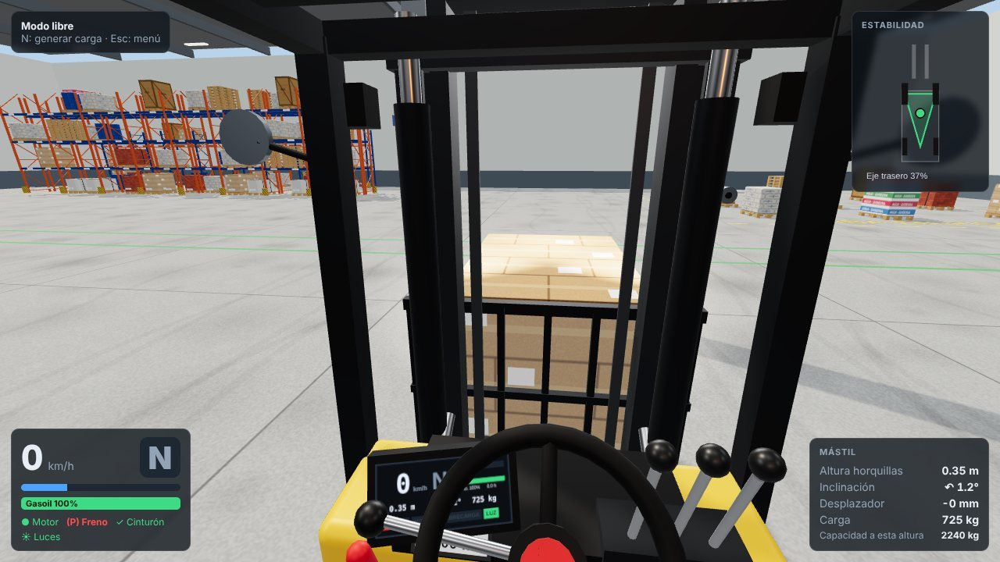
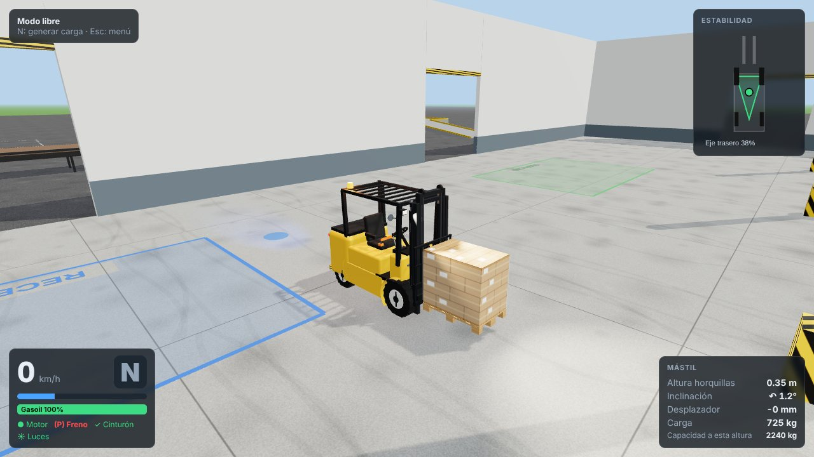
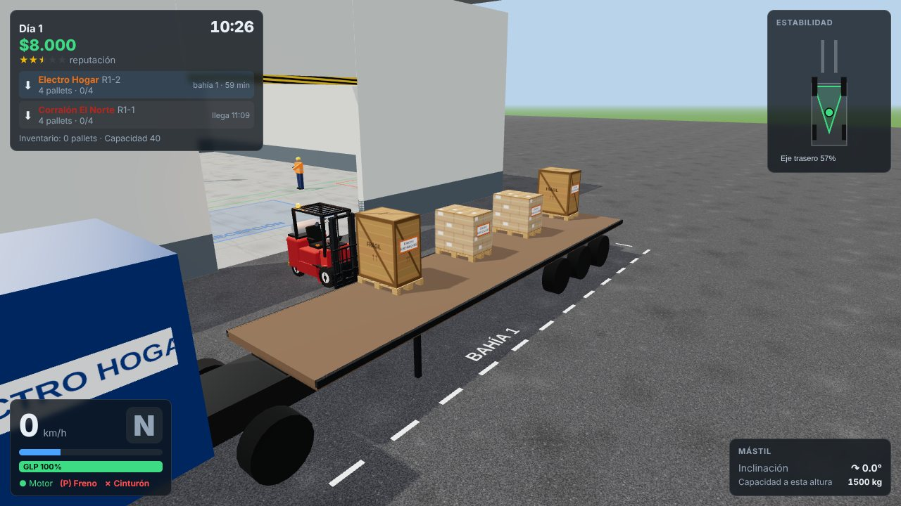

# Simulador de Autoelevador

Simulador 3D de **autoelevador contrapesado** para aprender a manejarlo de forma realista: dirección
trasera, triángulo de estabilidad, centro de carga, hidráulica proporcional, pallets con física real
y reglas de seguridad. Se juega en primera persona (accionando las palancas de la cabina con el
ratón) o en tercera persona, con teclado o con un joystick tipo PlayStation.

Hecho con [three.js](https://threejs.org/) (gráficos), [Rapier](https://rapier.rs/) (física) y
[Vite](https://vite.dev/) + TypeScript. Corre en el navegador, sin instalar nada.



| Tercera persona | Mi Almacén |
| --- | --- |
|  |  |

## Cómo jugar

Requisitos: [Node.js](https://nodejs.org/) 20 o superior y un navegador con WebGL 2 (Chrome, Edge o
Firefox actuales). El joystick es opcional.

```bash
cd simulador-autoelevador
npm install
npm run dev        # abrí http://localhost:5173
```

Versión estática para publicar en cualquier hosting (GitHub Pages, Netlify, una carpeta compartida):

```bash
npm run build      # genera dist/ con rutas relativas
npm run preview    # para probar la versión generada
```

Si el juego anda lento, en **⚙ Ajustes** bajá la calidad a *baja* (sin sombras y menos resolución).

## Modos de juego

### 🎓 Escuela de manejo

Ocho lecciones guiadas paso a paso. Cada una puntúa la técnica y descuenta puntos por choques,
cargas golpeadas o caídas, exceso de velocidad, horquillas altas, no mirar atrás en reversa, etc.
Se aprueba con 70 puntos y se ganan hasta 3 estrellas.

| # | Lección | Qué se aprende |
| - | --- | --- |
| 1 | Primeros pasos | Rutina de arranque (cinturón, palanca en N, llave), avanzar, frenar, reversa y estacionar |
| 2 | Dirección trasera | Slalom entre conos y estacionamiento en reversa: la cola se abre al girar |
| 3 | Tomar y trasladar un pallet | Entrar derecho, elevar, inclinar atrás, trasladar bajo y depositar |
| 4 | Estibar en estantería | Ubicar un pallet en el segundo nivel de un rack (1,50 m) |
| 5 | Retirar de altura | Sacar un pallet del tercer nivel (3,00 m) y bajarlo |
| 6 | Carga de camión | Cargar tres pallets en un camión playo por el costado |
| 7 | Rampa con carga | Subir una rampa del 13 % con la carga del lado de arriba y bajar en reversa |
| 8 | Examen final | Todo junto, con reglas estrictas |

### 🏗️ Modo libre

Centro de práctica sin presión: estanterías de hasta 4,5 m, camiones, rampa con plataforma, conos,
peatones y una zona de cargas variadas (cajas, bebidas, cemento, ladrillos, tambores, cerámicos,
bobinas de acero, máquinas, pilas de pallets). Desde la pausa se cambia de modelo de autoelevador y
con <kbd>N</kbd> se generan cargas nuevas.

### 📦 Mi Almacén

Gestioná tu propio depósito. Empezás con $8.000, una estantería y un autoelevador usado.

- **Jornada de 08:00 a 18:00** (unos 10 minutos reales). Antes de empezar ves la planilla con los
  camiones del día.
- **Recepción**: llega un camión con pallets; descargalos y guardalos en una estantería o en la zona
  de estiba en piso. Cobrás por pallet almacenado y una bonificación si terminás a tiempo.
- **Despacho**: un cliente viene a buscar mercadería; buscá sus pallets en tu inventario (etiqueta
  con su nombre, color y código) y cargalos en su camión.
- **Costos**: alquiler diario, combustible o energía (se carga en la zona CARGA con freno de mano),
  reparaciones por choques contra racks, paredes o camiones, mercadería dañada, atrasos, multas en
  las inspecciones de seguridad y accidentes.
- **Reputación** (estrellas): sube cumpliendo a tiempo y sin accidentes; trae más pedidos y paga mejor.
- **Tienda**: cinco autoelevadores (entregando el tuyo como parte de pago), accesorios (báscula,
  indicador de altura, cámara de horquillas, luz azul de seguridad, desplazador lateral),
  ampliaciones (más estanterías —las centrales de 4 niveles—, más bahías, tanque propio) y servicios
  (programa de seguridad, seguro de mercadería, publicidad).
- La partida se guarda sola al final de cada día (en el navegador). Si las deudas pasan de $10.000,
  quebrás.

## Controles

### Teclado

| Tecla | Acción |
| --- | --- |
| <kbd>W</kbd> / <kbd>S</kbd> | Acelerador / freno de servicio |
| <kbd>Shift</kbd> | Pedal de avance lento (*inching*): desembraga y, a fondo, frena. Con el acelerador eleva rápido sin avanzar |
| <kbd>A</kbd> / <kbd>D</kbd> | Volante (dirección trasera) |
| <kbd>E</kbd> / <kbd>Q</kbd> | Palanca de marcha: adelante / atrás (pasa por N) |
| <kbd>Espacio</kbd> | Freno de mano |
| <kbd>K</kbd> | Llave: arrancar / apagar (con la palanca en N) |
| <kbd>B</kbd> · <kbd>H</kbd> · <kbd>L</kbd> · <kbd>J</kbd> | Cinturón · bocina · luces · baliza |
| <kbd>↑</kbd> / <kbd>↓</kbd> | Elevar / bajar horquillas |
| <kbd>R</kbd> / <kbd>F</kbd> | Inclinar el mástil atrás / adelante |
| <kbd>←</kbd> / <kbd>→</kbd> | Desplazador lateral |
| <kbd>Z</kbd> / <kbd>X</kbd> | Posicionador de horquillas (si tiene) |
| <kbd>Ctrl</kbd> | Mantener: mando fino |
| <kbd>C</kbd> · <kbd>V</kbd> · <kbd>G</kbd> | Cambiar cámara · mirar atrás · monitor de la cámara de horquillas |
| <kbd>Inicio</kbd> · <kbd>Retroceso</kbd> | Centrar la vista · reubicar el autoelevador |
| <kbd>Esc</kbd> · <kbd>F1</kbd> | Pausa · ayuda |

### Joystick (DualShock 4, DualSense o Xbox, por USB o Bluetooth)

| Botón | Acción |
| --- | --- |
| Stick izquierdo ↔ | Volante (proporcional) |
| R2 / L2 | Acelerador / pedal de avance lento (a fondo frena; en eléctricos es el freno) |
| Stick derecho ↕ / ↔ | Elevar-bajar / inclinar (proporcionales) |
| L1 / R1 | Desplazador lateral |
| Cruceta ↑ / ↓ | Marcha adelante / atrás |
| ✕ · ○ · □ · △ | Llave · freno de mano · bocina · cámara |
| L3 · cruceta ← | Cinturón · luces |
| R3 mantenido + stick derecho | Mirar alrededor (toque de R3: centrar la vista) |
| Cruceta → | Mantener: mirar hacia atrás |
| Options · Share | Pausa · ayuda |
| Menús | Cruceta o stick izquierdo para moverse, ✕ aceptar, ○ volver |

### Ratón en la cabina (primera persona)

- **Mirar**: clic derecho y arrastrar (o clic izquierdo en una zona sin mandos). Rueda: zoom.
- **Palancas hidráulicas** (derecha del volante): clic y arrastrar hacia vos para *tirar*
  (subir / inclinar atrás / desplazar a la izquierda) o hacia adelante para *empujar*. Son
  proporcionales y vuelven al centro al soltarlas.
- **Volante**: agarrá el pomo y giralo en círculo. **Palanca de marcha** (izquierda de la columna):
  arrastrar arriba = F, abajo = R, muesca por muesca.
- **Llave y luces**: en el frente del tablero, debajo de las palancas. **Freno de mano**: palanca roja
  a la izquierda. **Cinturón**: hebilla naranja a la derecha del asiento. **Bocina**: centro del volante.

## Qué simula

- **Dirección trasera** con geometría de Ackermann: el contrapeso barre hacia afuera al girar.
- **Eje trasero pivotante** y **triángulo de estabilidad**: el centro de gravedad combinado
  (autoelevador + carga) se muestra en pantalla; girar rápido, frenar fuerte o circular con la carga
  alta lo saca del triángulo y el autoelevador vuelca (de costado o hacia adelante).
- **Centro de carga y placa de capacidad**: la capacidad baja con la altura y con cargas más largas;
  el sistema hidráulico tiene válvula de alivio, así que una sobrecarga no sube.
- **Mástil** dúplex o tríplex con elevación libre, inclinación, cadenas y desplazador lateral;
  posicionador de horquillas en el modelo pesado.
- **Hidráulica proporcional** cuyo caudal depende de las RPM del motor: acelerar en neutral (o con el
  pedal de avance lento) eleva más rápido, como en la realidad.
- **Transmisión** con convertidor de par (arrastre en ralentí, pedal de avance lento, frenado al
  invertir la marcha) en los modelos a gas y diésel; tracción eléctrica con regeneración en el
  eléctrico. Consumo de combustible o batería.
- **Ruedas** con fuerzas normales reales, círculo de fricción, resistencia a la rodadura y frenos.
- **Pallets** como cuerpos rígidos con tacos y tablas: las horquillas tienen que entrar por las
  aberturas, la carga puede deslizarse o caerse con frenadas y giros bruscos, y la **báscula**
  mide el peso real que llevan las horquillas.
- **Daños**: choques contra estanterías, paredes, camiones y cargas, con su costo en el modo almacén.
- **Seguridad**: 15 reglas evaluadas en vivo (cinturón, horquillas altas al circular, velocidad,
  giro brusco, mástil adelante con carga, sobrecarga, invertir la marcha en movimiento, mirar atrás
  en reversa, freno de mano, rampas, peatones, frenadas bruscas con carga, elevar en marcha, dejar la
  carga en alto…). Hay peatones que se detienen o se distraen.
- **Cámaras**: cabina (con mirada libre y mirar atrás), tercera persona, cámara de horquillas y aérea.
- **Sonido** sintetizado: motor, hidráulica, alarma de retroceso, bocina, chirridos y golpes.

### Modelos

| Modelo | Energía | Capacidad | Altura máx. | Extras | Precio |
| --- | --- | --- | --- | --- | --- |
| Toro 15 (usado) | GLP | 1.500 kg | 3,0 m | — | $9.000 |
| Puma 25 | Diésel | 2.500 kg | 3,3 m | Desplazador lateral | $32.000 |
| Volt 18 | Eléctrico | 1.800 kg | 4,7 m (tríplex) | Elevación libre total | $41.000 |
| Cóndor 20 | Diésel | 2.000 kg | 6,0 m (tríplex) | Para racks altos | $52.000 |
| Titán 35 | Diésel | 3.500 kg | 4,0 m | Posicionador de horquillas | $58.000 |

## Estructura

```
src/
  sim/        física: autoelevador (ruedas, tren de potencia, hidráulica, mástil), pallets, modelos
  render/     modelo 3D del autoelevador, cámaras, tablero, materiales y texturas procedurales
  world/      mundo: escenario, estanterías, camiones, rampas, zonas, peatones, pallets instanciados
  game/       sesión de juego, reglas de seguridad, daños, interacción con la cabina
  input/      teclado, ratón y joystick (Gamepad API) → mandos del autoelevador
  modes/      escuela (lecciones), modo libre y Mi Almacén (economía, pedidos, tienda)
  ui/         menús, HUD y ayuda
  audio/      sonido sintetizado con Web Audio
tests/        experimentos de física en Node y pruebas de punta a punta en el navegador
```

## Pruebas

**Física** (Node, sin navegador): scripts que arman una escena y muestran mediciones (aceleración,
frenado, estabilidad, báscula, vuelco, etc.):

```bash
node --experimental-strip-types tests/t1-basic.ts
node --experimental-strip-types tests/t9-tip.ts
```

**De punta a punta** (Chromium sin pantalla con [Playwright](https://playwright.dev/)): un piloto
automático maneja el autoelevador real del juego. Con `npm run dev` corriendo:

```bash
npm i -D playwright && npx playwright install chromium   # una sola vez
node tests/e2e/lesson.mjs all     # aprueba las 8 lecciones (o: lesson.mjs 4)
node tests/e2e/business.mjs       # Mi Almacén: descarga, cobro, cierre del día, tienda, despacho
node tests/e2e/cab-mouse.mjs      # mandos de cabina con el ratón
node tests/e2e/gamepad.mjs        # joystick simulado: menús, manejo, hidráulica, cámara
```

Cada prueba imprime `RESULTADOS` y termina con error si algo falla; las capturas quedan en
`tests/e2e/out/`. (`BASE_URL` cambia la dirección del juego.)
